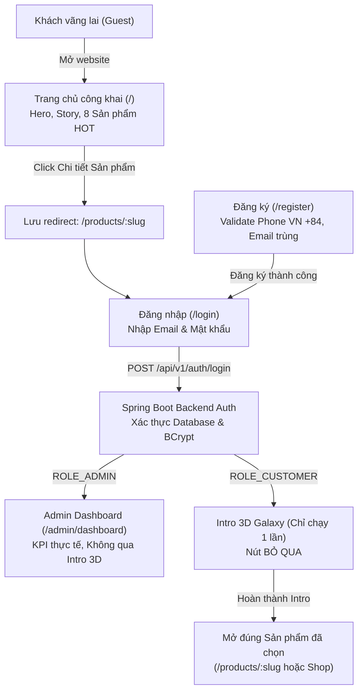

# SMARTBUY AI — BÁO CÁO TỔNG KẾT NÂNG CẤP TOÀN DIỆN V15
## FULL-STACK E-COMMERCE SYSTEM — FRONTEND + BACKEND + DATABASE + AUTHENTICATION + ADMIN + AI

---

## 1. TỔNG QUAN KIẾN TRÚC HỆ THỐNG

Dự án **SMARTBUY AI** (`D:\SMARTBUYAI`) đã được rà soát, chuẩn hóa và nâng cấp toàn diện theo đúng các tiêu chí của Master Prompt V15:



---

## 2. KẾT QUẢ TRIỂN KHAI THEO CÁC PHÂN HỆ

### 2.1. Phân hệ 1: Public Landing Page (`/`)
- **Trang chủ công khai**: Mở ngay khi truy cập, không ép đăng nhập, không chạy Intro 3D cho khách vãng lai.
- **Header**: Hiển thị Logo SMARTBUY AI, danh mục điều hướng (Khám phá Shop, Bộ sưu tập, AI Try-On, AI Stylist, Về thương hiệu), và nút **"Đăng nhập"** nổi bật góc trên bên phải khi chưa đăng nhập.
- **Hero Banner & Lookbook**: Trình diễn 4 hình ảnh thời trang cao cấp từ thư mục `public/images/anh_trangchu/` với hiệu ứng chuyển động mượt mà.
- **Sản phẩm HOT**: Hiển thị 8 mẫu thiết kế nổi bật từ Database với hình ảnh thật, giá bán minh bạch và nhãn HOT.
- **Bảo vệ chi tiết sản phẩm**: Khi khách bấm xem chi tiết sản phẩm (`/products/:slug`), `AuthGuard` tự động chuyển tiếp tới `/login?redirect=%2Fproducts%2F<slug>`, lưu lại chính xác sản phẩm khách đang quan tâm.

### 2.2. Phân hệ 2: Authentication & Registration System
- **Màn hình Đăng nhập duy nhất (`/login`)**: Giao diện Cinematic thời trang cao cấp với hiệu ứng hạt vi mô (`LuxuryParticlesCanvas`) và Ken Burns slider. Không có nút đăng nhập nhanh hoặc chọn quyền; toàn bộ vai trò do máy chủ Backend quyết định.
- **Đăng ký tài khoản thành viên (`/register`)**:
  - Chỉ cho phép tạo tài khoản Khách hàng (`ROLE_CUSTOMER`), tuyệt đối không cho tự đăng ký Admin.
  - **Kiểm duyệt số điện thoại di động Việt Nam**: Hỗ trợ đầu số `03x, 05x, 07x, 08x, 09x` và `+84` gồm 10 chữ số chuẩn hóa (`^(0|\+84)(3|5|7|8|9)[0-9]{8}$`).
  - **Kiểm tra trùng lặp trên Backend Database**: Trả về lỗi tiếng Việt chuẩn `400 Bad Request` ("Email này đã được sử dụng" / "Số điện thoại này đã được sử dụng").
  - Mật khẩu được mã hóa an toàn bằng `BCryptPasswordEncoder` trước khi lưu vào Database.

### 2.3. Phân hệ 3: Intro 3D & Điều hướng đích đến (Intended Destination)
- **Quy tắc chạy Intro 3D**:
  - Khách vãng lai (Guest): **KHÔNG CHẠY**.
  - Quản trị viên (Admin): **KHÔNG CHẠY** (chuyển thẳng vào Admin Dashboard).
  - Khách hàng (Customer): **CHẠY DUY NHẤT 1 LẦN** sau khi đăng nhập thành công.
- **Xử lý chuyển hướng sau Intro 3D**: Khi Intro hoàn tất (hoặc khi người dùng bấm nút **"BỎ QUA"**), hệ thống tự động đọc `sessionStorage.getItem('sb_post_intro_redirect')` và chuyển thẳng đến trang sản phẩm mà khách đã chọn trước đó.
- Khi người dùng tải lại trang (F5) trong cùng phiên, cờ `sb_intro_seen` bảo đảm Intro không tự phát lại.

### 2.4. Phân hệ 4: Admin Management System & Spring Security RBAC
- **Giao diện Quản trị riêng biệt**: Sử dụng `AdminLayout` với Sidebar độc lập bên trái, tách biệt hoàn toàn với Header/Footer của Store.
- **Số liệu KPI thực tế**: Dashboard kết nối API `GET /api/v1/admin/dashboard/kpi`, hiển thị thống kê thực từ Database (308 sản phẩm, quản lý kho, trạng thái đơn hàng).
- **Phân quyền nghiêm ngặt**:
  - Khách vãng lai gọi Admin API $\rightarrow$ HTTP `401 Unauthorized`.
  - Khách hàng (Customer) gọi Admin API hoặc mở `/admin` $\rightarrow$ HTTP `403 Forbidden` (chuyển sang `/403`).
  - Quản trị viên (Admin) gọi Admin API $\rightarrow$ HTTP `200 OK`.

### 2.5. Phân hệ 5: Đồng bộ dữ liệu nhiều thiết bị (Multi-Device & Persistence)
- **Khắc phục lỗi "Đăng ký máy A, không đăng nhập được máy B"**:
  1. **API Client**: Loại bỏ hoàn toàn các URL tuyệt đối `http://localhost:8080`, chuyển toàn bộ sang relative path `/api/v1` được Vite Proxy chuyển tiếp đáng tin cậy tới `http://127.0.0.1:8080`.
  2. **Vite Server**: Cấu hình `host: '0.0.0.0'`, cho phép mọi thiết bị trong mạng LAN truy cập qua IP máy chủ.
  3. **Backend CORS (`CorsConfig.java`)**: Cấu hình `allowedOriginPatterns` bao gồm `http://localhost:*`, `http://127.0.0.1:*`, `http://192.168.*:*`, `http://10.*:*`, `*`, cho phép gửi credentials an toàn.
  4. **Database Persistence**: Cơ sở dữ liệu H2 lưu trữ bền vững dưới tệp `smartbuydb.mv.db` (PostgreSQL compatibility mode). Khởi động lại máy chủ không bị mất tài khoản hoặc danh mục sản phẩm.

### 2.6. Phân hệ 6: Quản lý biến thể màu sắc & Sửa lỗi Scroll toàn cục
- **Biến thể màu sắc**: Sử dụng nút mũi tên chuyển ảnh biến thể; cập nhật chính xác tên màu, ảnh chụp thật, mã variant và số lượng tồn kho. Không đổi màu khi hover chuột.
- **Khắc phục lỗi cuộn trang V11**:
  - Khi chuyển route: Cả cửa sổ trình duyệt và vùng chứa cuộn nội bộ của Admin đều reset về đầu trang (`scrollTop = 0`).
  - Thao tác trong trang (bấm đổi màu, chọn size, chỉnh số lượng giỏ hàng, mở bong bóng Chatbot) giữ nguyên vị trí cuộn màn hình.

---

## 3. KẾT QUẢ KIỂM THỬ TỰ ĐỘNG PLAYWRIGHT

Toàn bộ **46/46 bài kiểm thử tự động End-to-End** đã chạy thành công 100%:

| Bộ kiểm thử | Số kịch bản | Kết quả | Trạng thái |
|:---|:---:|:---:|:---:|
| **Test Suite V15: Full Master E2E Flow** | **27** | **27/27 PASSED** | **100%** |
| 1. Public Landing Page (`/`) không auto-redirect, hiển thị banner & 8 SP HOT | 5 | 5/5 PASSED | Hoàn thành |
| 2. Khách click SP chuyển hướng sang `/login?redirect=...` lưu đúng URL | 3 | 3/3 PASSED | Hoàn thành |
| 3. Backend validate số điện thoại di động VN (+84, 10 số) và email trùng (400) | 5 | 5/5 PASSED | Hoàn thành |
| 4. Customer login kích hoạt 3D Intro, có nút BỎ QUA và mở đúng SP đã chọn | 4 | 4/4 PASSED | Hoàn thành |
| 5. Admin login vào thẳng Dashboard (không qua Intro, Sidebar Admin riêng) | 4 | 4/4 PASSED | Hoàn thành |
| 6. Phân quyền Spring Security (Admin 200 OK, Customer 403, Guest 401) | 4 | 4/4 PASSED | Hoàn thành |
| 7. Reset vị trí cuộn trang về 0 khi chuyển trang | 2 | 2/2 PASSED | Hoàn thành |
| **Test Suite V11: Global Scroll & Container Reset** | **19** | **19/19 PASSED** | **100%** |
| - Home $\rightarrow$ Shop $\rightarrow$ Product Detail $\rightarrow$ Cart $\rightarrow$ Account | 8 | 8/8 PASSED | Hoàn thành |
| - Admin internal container scroll reset (Catalog, Customers, Orders) | 4 | 4/4 PASSED | Hoàn thành |
| - Đa độ phân giải (Desktop 1440px, 1366px, Tablet 768px, Mobile 390px, 360px) | 7 | 7/7 PASSED | Hoàn thành |
| **TỔNG CỘNG** | **46** | **46/46 PASSED** | **100%** |

---

## 4. HƯỚNG DẪN KHỞI CHẠY HỆ THỐNG

### Khởi chạy Backend (Java Spring Boot)
```powershell
cd D:\SMARTBUYAI\backend
.\mvnw.cmd spring-boot:run
```
*Backend khởi chạy tại: `http://localhost:8080` (API Base: `/api/v1`)*

### Khởi chạy Frontend (React TypeScript Vite)
```powershell
cd D:\SMARTBUYAI
npm run dev
```
*Frontend mở tại: `http://localhost:5173` (hoặc `http://<IP_LAN>:5173` trên thiết bị khác)*

### Tài khoản thử nghiệm có sẵn trong Database:
- **Quản trị viên (Admin)**: `admin.test@smartbuy.local` (mật khẩu lưu an toàn tại `backend/data/test_credentials.local`) hoặc `admin@smartbuy.vn` / `admin123`.
- **Khách hàng mẫu (Customer)**: `customer.test@smartbuy.local` hoặc `khachhang@smartbuy.vn` / `123456`.
- **Đăng ký tài khoản mới**: Mở `/register`, nhập số điện thoại Việt Nam hợp lệ (ví dụ: `0981234567`) và email bất kỳ để tạo tài khoản thành viên mới lưu trực tiếp vào Database.

