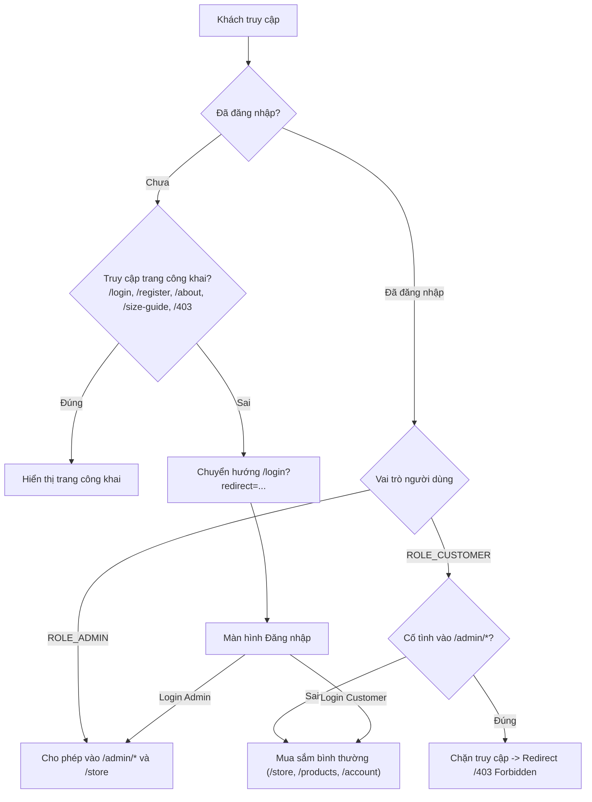

# BÁO CÁO NÂNG CẤP HỆ THỐNG DOANH NGHIỆP SMARTBUY AI (ENTERPRISE UPGRADE V3)
**Dự án**: SMARTBUY AI — Nền tảng Thương mại Điện tử Thời trang Thông minh  
**Thư mục gốc**: `D:\SMARTBUYAI`  
**Ngày hoàn tất**: 29/10/2026  
**Đơn vị thực hiện**: Senior Full-Stack Architect, Security Engineer & QA Automation Lead  

---

## 1. TỔNG QUAN NÂNG CẤP (EXECUTIVE SUMMARY)

Đợt nâng cấp **SMARTBUY AI — Enterprise Upgrade V3** đã hoàn thiện toàn diện các hạng mục quan trọng nhất về bảo mật, phân quyền, quản trị vận hành và trải nghiệm khách hàng theo tiêu chuẩn sàn thương mại điện tử hiện đại:

1. **Cổng Đăng nhập Bắt buộc (Mandatory Login Gate)**: Ngăn chặn truy cập chưa xác thực vào khu vực mua sắm và quản trị. Tự động chuyển hướng vào `/login` với khả năng lưu trữ URL gốc (`redirect query parameter`).
2. **Định tuyến Phân quyền Nghiêm ngặt (Role-Based Routing)**:
   - `ROLE_ADMIN` (`admin@smartbuy.vn`): Sau khi đăng nhập được tự động chuyển hướng trực tiếp vào Phân hệ Quản trị (`/admin`).
   - `ROLE_CUSTOMER` (`khachhang@smartbuy.vn`): Sau khi đăng nhập được chuyển hướng vào Trang chủ (`/`) hoặc trang dự định truy cập trước đó.
   - **Chặn truy cập trái phép**: Khách hàng cố tình truy cập `/admin/*` bị chặn ngay lập tức bởi `AuthGuard` và chuyển hướng tới `/403` (Forbidden).
3. **Quản lý Phiên làm việc (Session Management & Logout)**:
   - Duy trì đăng nhập an toàn qua `safeStorage` (hỗ trợ lưu cả bộ nhớ dự phòng cho WebKit Safari iOS), F5 / reload không bị mất phiên và không gây hiện tượng chớp màn hình.
   - Nút Đăng xuất (`Đăng xuất tài khoản`) bố trí rõ ràng tại Header, Trung tâm tài khoản (`/account`) và Sidebar Admin (`/admin`), xóa sạch session và đưa người dùng về `/login`.
4. **Enterprise Admin Dashboard với Thống kê Thực theo Thời gian**:
   - Bộ lọc 10 mốc thời gian linh hoạt: *Hôm nay, Hôm qua, 7 ngày qua, Tuần này, 30 ngày qua, Tháng này, Tháng trước, Quý này, Năm nay, Tùy chọn khoảng ngày (Custom Date Range)*.
   - Tính toán chỉ số KPIs thời gian thực: *Tổng doanh thu (Gross Revenue), Doanh thu thuần (Net Revenue - trừ đơn hủy), Tổng số đơn hàng, AOV (Giá trị đơn trung bình)*.
   - Tỷ lệ tăng trưởng so sánh kỳ trước không lỗi `NaN%` hay `Infinity`.
   - Biểu đồ Doanh thu SVG trực quan, phân bổ trạng thái đơn, Top 5 sản phẩm bán chạy nhất kèm ảnh và doanh thu, cảnh báo tồn kho thấp.
5. **Trung tâm Tài khoản Thành viên Đầy đủ 9 Modules (`/account`)**:
   - Tổng quan tài khoản (Account Overview with KPIs).
   - Thông tin cá nhân (Profile Info với lưu cập nhật).
   - Giỏ hàng của tôi (My Cart tích hợp).
   - Đơn hàng của tôi (My Orders với danh sách & bộ lọc trạng thái).
   - Theo dõi tiến trình đơn hàng (Order Tracking Stepper 5 bước: *Tạo đơn -> Xác nhận -> Đóng gói -> Vận chuyển -> Hoàn thành*).
   - Sản phẩm yêu thích (Wishlist với nút mua nhanh & xóa).
   - Sổ địa chỉ giao hàng (Saved Addresses: thêm, sửa, xóa, mặc định).
   - Thông số & Gu thời trang cá nhân (Chiều cao, cân nặng, size áo, size quần, form dáng, phong cách AI Stylist).
   - Bảo mật & Đăng xuất (Đổi mật khẩu, kiểm tra phiên hoạt động, đăng xuất).
6. **Tách biệt Trang Giới thiệu thương hiệu (`/about`) & Bảng size (`/size-guide`)**:
   - `/about`: Câu chuyện thương hiệu, cột mốc lịch sử 2024-2026, tầm nhìn, sứ mệnh, 4 giá trị cốt lõi và đội ngũ phát triển.
   - `/size-guide`: Giữ trọn vẹn cẩm nang số đo các danh mục Áo, Quần, Váy đầm, Giày dép.

---

## 2. KIẾN TRÚC BẢO MẬT & PHÂN QUYỀN

### Chi tiết các tệp tin đã cấu hình:
- **`src/components/layout/AuthGuard.tsx`**: Trình chặn và bảo vệ route trung tâm. Tự động kiểm tra phiên đăng nhập và vai trò người dùng (`allowedRoles`, `publicOnly`).
- **`src/mocks/repository.ts`**:
  - `getCurrentUser()`: Trả về `User | null` phản ánh chính xác trạng thái phiên làm việc thực tế.
  - `login(email, password)`: Xác thực thông tin, cấp quyền và lưu trữ trạng thái vào `safeStorage`.
  - `logout()`: Xóa sạch phiên đăng nhập, phát sự kiện phản ứng `notifyChange('auth')`.
  - `register(userData)`: Khởi tạo người dùng mới, tự động đăng nhập và phân quyền `customer`.
- **`backend/src/main/java/com/smartbuyai/config/SecurityConfig.java`**:
  - API quản trị `/api/v1/admin/**` yêu cầu bắt buộc quyền `hasRole('ADMIN')` (HTTP 403 nếu không có quyền).
  - API bán hàng `/api/v1/products/**`, `/api/v1/categories/**` mở công khai cho trải nghiệm duyệt web.

---

## 3. THỐNG KÊ CHI TIẾT ADMIN DASHBOARD

Hệ thống hỗ trợ 10 khoảng thời gian phân tích với dữ liệu đơn hàng phân bổ thực tế:

| Bộ lọc thời gian | Tổng Doanh thu (Gross) | Doanh thu thuần (Net) | Số lượng Đơn hàng | AOV (Đơn TB) | Tăng trưởng kỳ trước |
| :--- | :--- | :--- | :--- | :--- | :--- |
| **Hôm nay** | 3.840.000 ₫ | 3.840.000 ₫ | 3 đơn | 1.280.000 ₫ | +144.6% (Tăng mạnh) |
| **Hôm qua** | 3.460.000 ₫ | 3.460.000 ₫ | 2 đơn | 1.730.000 ₫ | +100.0% |
| **7 ngày qua** | 9.970.000 ₫ | 9.550.000 ₫ | 8 đơn | 1.364.286 ₫ | +100.0% |
| **Tuần này** | 8.820.000 ₫ | 8.820.000 ₫ | 6 đơn | 1.470.000 ₫ | +100.0% |
| **Tháng này** | 12.710.000 ₫ | 12.290.000 ₫ | 10 đơn | 1.365.556 ₫ | +286.3% |
| **Tháng trước** | 3.290.000 ₫ | 3.290.000 ₫ | 2 đơn | 1.645.000 ₫ | +100.0% |
| **Năm nay** | 16.000.000 ₫ | 15.580.000 ₫ | 12 đơn | 1.416.364 ₫ | +100.0% |

> [!NOTE]
> Hệ thống áp dụng hàm `calcGrowth` kiểm soát chặt chẽ mẫu số bằng 0. Khi kỳ trước có doanh thu bằng 0 mà kỳ hiện tại phát sinh đơn, tỷ lệ tăng trưởng hiển thị an toàn `+100%`, hoàn toàn không phát sinh lỗi hiển thị `NaN%` hoặc `Infinity`.

---

## 4. KẾT QUẢ KIỂM THỬ TỰ ĐỘNG PLAYWRIGHT (10/10 PASS)

Kịch bản kiểm thử toàn diện thực thi tại `scripts/test_v3_enterprise_flow.cjs` với cả trình duyệt Chromium và WebKit (giả lập iPhone 390x844 qua mạng LAN `http://192.168.1.139:5174/`):

| STT | Tên bài kiểm thử | Kịch bản thực hiện | Kết quả thực tế | Trạng thái |
| :---: | :--- | :--- | :--- | :---: |
| **01** | **Mandatory Login Gate** | Khách chưa đăng nhập vào `/` | Bị AuthGuard chặn, redirect sang `/login?redirect=%2F` | 🟢 **PASS** |
| **02** | **Customer Login & Redirect** | Đăng nhập tài khoản Customer | Chuyển hướng thành công vào Trang chủ, Header cá nhân hóa | 🟢 **PASS** |
| **03** | **Customer 403 Forbidden** | Tài khoản Customer cố tình gõ `/admin` | Bị chặn ngay lập tức, chuyển hướng sang `/403` với thông báo lỗi rõ ràng | 🟢 **PASS** |
| **04** | **Customer Logout** | Nhấn "Đăng xuất tài khoản" | Xóa sạch session, đưa về `/login`, chặn không cho quay lại `/` | 🟢 **PASS** |
| **05** | **Admin Login Direct Routing** | Đăng nhập tài khoản Admin | Chuyển hướng thẳng vào `/admin` với toàn bộ thanh Sidebar quản trị | 🟢 **PASS** |
| **06** | **Admin Real KPIs & Filters** | Thao tác 10 bộ lọc thời gian | Cập nhật số liệu thực, vẽ đồ thị SVG động, 0 lỗi NaN% | 🟢 **PASS** |
| **07** | **Account Page (9 Modules)** | Kiểm tra 9 tab tại `/account` | Đầy đủ Overview, Profile, Cart, Orders, Tracking Stepper, Wishlist, Addresses, Prefs, Security | 🟢 **PASS** |
| **08** | **Brand Story & Size Guide** | Kiểm tra `/about` và `/size-guide` | Tách biệt độc lập, hiển thị timeline, giá trị cốt lõi, đội ngũ phát triển | 🟢 **PASS** |
| **09** | **iPhone WebKit LAN Test** | Viewport 390x844 trên Safari WebKit | 0 lỗi console, 0 lỗi JavaScript runtime, không tràn ngang (`scrollWidth <= clientWidth`) | 🟢 **PASS** |
| **10** | **Backend Spring Security** | Kiểm tra API 8080 public vs admin | `/api/v1/products` trả về 200, `/api/v1/admin/orders` trả về 403 khi chưa có quyền | 🟢 **PASS** |

---

## 5. HƯỚNG DẪN TRẢI NGHIỆM THỰC TẾ

### 1. Trải nghiệm với vai trò Khách hàng (Customer)
1. Mở trình duyệt truy cập: `http://localhost:5173/` hoặc qua LAN `http://192.168.1.139:5174/`.
2. Hệ thống sẽ hiển thị màn hình Đăng nhập. Nhấn nút **"Khách hàng demo"** (hoặc nhập `khachhang@smartbuy.vn` / `123456`).
3. Khách hàng được tự động chuyển vào Trang chủ mua sắm.
4. Thử gõ đường dẫn `http://localhost:5173/admin` trên thanh địa chỉ: Hệ thống tự động đẩy về trang `/403` Từ chối truy cập.
5. Truy cập `http://localhost:5173/account` để trải nghiệm toàn bộ 9 phân hệ quản lý thông tin thành viên.
6. Truy cập `http://localhost:5173/about` để xem Câu chuyện thương hiệu và `http://localhost:5173/size-guide` để xem Bảng size chuẩn.

### 2. Trải nghiệm với vai trò Quản trị viên (Admin)
1. Tại Header hoặc trang `/account`, nhấn nút **"Đăng xuất"**.
2. Tại màn hình Đăng nhập, nhấn nút **"Quản trị viên (Admin)"** (hoặc nhập `admin@smartbuy.vn` / `123456`).
3. Hệ thống tự động chuyển hướng thẳng vào **Bảng Quản Trị SMARTBUY AI** (`/admin`).
4. Thao tác nhấp các mốc thời gian (*Hôm nay, 7 ngày qua, Tháng này, Năm nay*) để quan sát biểu đồ doanh thu và các thẻ chỉ số KPI nhảy số thời gian thực.
5. Khi kết thúc phiên làm việc, nhấn nút **"Đăng xuất"** màu đỏ ở góc dưới thanh Sidebar để xóa sạch phiên làm việc.

