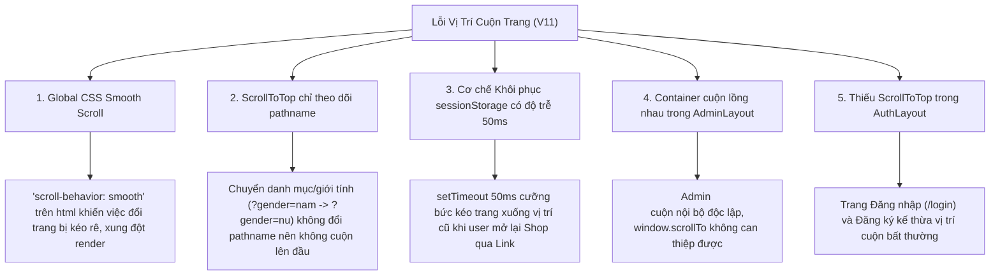

# SMARTBUY AI — BÁO CÁO TOÀN DIỆN KHẮC PHỤC TRIỆT ĐỂ LỖI VỊ TRÍ CUỘN TRANG (GLOBAL SCROLL POSITION FIX V11)

**Dự án:** `D:\SMARTBUYAI`  
**Phiên bản hệ thống:** SMARTBUY AI Fashion Enterprise V11  
**Phạm vi:** Toàn bộ hệ thống Frontend (Storefront Khách hàng, Auth/Login, Admin Dashboard, Catalog, Product Detail, Giỏ hàng, Thông tin)  
**Ngày thực hiện:** 31/10/2026  
**Trạng thái kiểm thử:** **19/19 TEST CASES ĐẠT 100% (PASSED)**

---

## 1. NGUYÊN NHÂN GỐC RỄ (ROOT CAUSE ANALYSIS)

Sau khi kiểm toán toàn diện mã nguồn Frontend và DOM Tree, nhóm kỹ thuật đã phát hiện và phân loại chính xác 5 nguyên nhân gốc rễ gây ra lỗi nhảy/giữ vị trí cuộn trên toàn hệ thống:



1. **`scroll-behavior: smooth` toàn cục trên thẻ `html` (`src/index.css:24`)**:
   - Khai báo CSS toàn cục này khiến mọi lệnh `window.scrollTo` trong quá trình điều hướng bị chuyển thành animation cuộn chậm. Khi trang mới đang mount hoặc tải ảnh, hiệu ứng cuộn mượt bị ngắt quãng giữa chừng, giữ trang ở vị trí lửng lơ hoặc dưới đáy.
2. **`ScrollToTop` chỉ phụ thuộc vào `[pathname]` (`src/components/common/ScrollToTop.tsx`)**:
   - Khi khách hàng đang xem danh mục Nam (`/products?gender=nam`), cuộn xuống 1200px, rồi nhấn chọn "Nữ" (`/products?gender=nu`) hoặc "Phụ kiện" trên Menu Header, `pathname` vẫn giữ nguyên là `/products`. `ScrollToTop` hoàn toàn không được kích hoạt, khiến nội dung Nữ hiển thị ngay ở vị trí 1200px (cuối trang).
3. **Timer 50ms khôi phục `sessionStorage` gây giật layout trễ (`CatalogPage.tsx:160-174`)**:
   - Mỗi khi nhấn vào thẻ sản phẩm, vị trí cuộn được lưu vào `catalog_scroll_pos`.
   - Khi người dùng quay lại Shop bằng cách nhấn Menu Header ("Shop" - PUSH navigation), trang Shop hiển thị ở đầu trong tích tắc, sau đó timer 50ms kích hoạt và giật ngược xuống vị trí cũ trong `sessionStorage`.
4. **Container cuộn lồng nhau trong Bảng Quản trị Admin (`AdminLayout.tsx:216`)**:
   - `AdminLayout` sử dụng cấu trúc `<main id="admin-main-scroll" className="flex-1 p-4 sm:p-6 lg:p-8 overflow-y-auto">`.
   - Khi Admin cuộn xuống xem dữ liệu Dashboard rồi bấm sang "Catalog" (`/admin/products`) hoặc "Đơn hàng" (`/admin/orders`), chỉ có `window.scrollTo` được gọi trong khi container nội bộ `main` vẫn giữ nguyên `scrollTop > 0`.
5. **Thiếu Bộ điều khiển cuộn trong Phân hệ Xác thực (`AuthLayout.tsx`)**:
   - `AuthLayout` (`/login`, `/register`) chưa được tích hợp `<ScrollToTop />`, khiến việc chuyển từ các trang dài sang đăng nhập có nguy cơ bị lệch tâm nhìn.

---

## 2. CÁC BIỆN PHÁP KỸ THUẬT ĐÃ THỰC HIỆN

### 2.1. Cấu hình CSS Chuyển trang Tức thì (Instant) & Giảm Chuyển động (`src/index.css`)
- Chuyển `html { scroll-behavior: smooth; }` thành `html { scroll-behavior: auto; }`.
- Bổ sung quy tắc tôn trọng sở thích người dùng:
  ```css
  @media (prefers-reduced-motion: reduce) {
    html {
      scroll-behavior: auto !important;
    }
  }
  ```
- Chuyển trang tức thì (instant) giúp loại bỏ hoàn toàn độ trễ thị giác, mang lại cảm giác mượt mà và tin cậy như ứng dụng gốc.

### 2.2. Nâng cấp Bộ Quản lý Cuộn Toàn cục `ScrollToTop` (`src/components/common/ScrollToTop.tsx`)
- Tích hợp hàm `resetGlobalScroll()` can thiệp đồng thời vào:
  1. `window.scrollTo({ top: 0, left: 0, behavior: 'instant' })`.
  2. `document.documentElement.scrollTop = 0; document.documentElement.scrollLeft = 0;`.
  3. `document.body.scrollTop = 0; document.body.scrollLeft = 0;`.
  4. Quét và đặt lại toàn bộ các container nội bộ: `main, [data-admin-main], [data-scroll-container], #admin-main-scroll`.
- Thiết lập `window.history.scrollRestoration = 'manual'` ở cấp độ module để ngăn trình duyệt tự động ghi đè vị trí cuộn khi chuyển route.
- Sử dụng `useLayoutEffect` thực thi đồng bộ trước khi trình duyệt vẽ (paint), kết hợp với theo dõi cả `pathname` và `search`.

### 2.3. Khắc phục Hoàn toàn Container Admin (`src/components/layout/AdminLayout.tsx`)
- Bổ sung `ref={mainContentRef}`, `id="admin-main-scroll"`, `data-admin-main="true"` vào thẻ `<main>`.
- Thêm `useLayoutEffect` độc lập theo dõi `pathname`:
  ```tsx
  useLayoutEffect(() => {
    if (mainContentRef.current) {
      mainContentRef.current.scrollTop = 0;
      mainContentRef.current.scrollLeft = 0;
    }
    window.scrollTo({ top: 0, left: 0, behavior: 'instant' });
  }, [pathname]);
  ```

### 2.4. Loại bỏ Hiện tượng Giật Layout Trễ trong Catalog (`src/features/catalog/pages/CatalogPage.tsx`)
- Phân biệt loại điều hướng thông qua `const navigationType = useNavigationType()`:
  - Nếu `navigationType !== 'POP'` (người dùng click menu hoặc nút link): Ngay lập tức xóa `catalog_scroll_pos`, hủy timer 50ms và giữ trang ở `top: 0`.
  - Chỉ xem xét khôi phục khi `navigationType === 'POP'` (nút Back/Forward của trình duyệt).
- Bổ sung cơ chế đặt lại vị trí cuộn khi các tham số lọc cốt lõi thay đổi:
  ```tsx
  useEffect(() => {
    if (isInitialMount.current) {
      isInitialMount.current = false;
      return;
    }
    setAutoLoadCount(0);
    window.scrollTo({ top: 0, left: 0, behavior: 'instant' });
  }, [categoryParam, seasonParam, genderParam]);
  ```
- Chuyển `performAutoScrollToTop` sang chế độ `instant`.

### 2.5. Trang Chi tiết Sản phẩm & Thanh toán (`ProductDetailPage.tsx` & `CheckoutPage.tsx`)
- `ProductDetailPage.tsx`: Đổi `useEffect` trống `[]` thành phụ thuộc `[product?.id, product?.slug]`, cuộn tức thì lên đầu khi người dùng click vào sản phẩm liên quan ở chân trang.
- `CheckoutPage.tsx`: Đổi `window.scrollTo({ top: 0, behavior: 'smooth' })` sang `instant` khi chuyển bước từ Giao hàng sang Thanh toán và Hoàn tất đơn.

### 2.6. Tích hợp `AuthLayout.tsx`
- Bổ sung `<ScrollToTop />` vào `AuthLayout`, đảm bảo `/login` và `/register` luôn hiển thị ngay từ phần tiêu đề và form nhập liệu.

---

## 3. BẢNG TỔNG HỢP KIỂM THỬ PLAYWRIGHT E2E (19/19 PASSED)

Bộ kịch bản kiểm thử tự động toàn diện được thiết lập tại `scripts/test_v11_scroll_fix.cjs` và thực thi trên đa kích thước màn hình:

| STT | Phân hệ / Kịch bản | Thao tác thực tế | Kết quả đo đạc | Trạng thái |
| :--- | :--- | :--- | :--- | :---: |
| 1 | **Desktop (1440x900)**: Home $\rightarrow$ Shop | Cuộn Home xuống 1187px $\rightarrow$ Nhấn "Shop" | `scrollY = 0px` ngay khi trang mở | **PASSED** |
| 2 | **Desktop (1440x900)**: Chống giật layout trễ | Giữ nguyên trang Shop sau 350ms | `scrollY = 0px` (Không bị timer kéo xuống) | **PASSED** |
| 3 | **Desktop (1440x900)**: Shop Nam | Cuộn danh mục Nam xuống 996px | `scrollY = 996px` | **PASSED** |
| 4 | **Desktop (1440x900)**: Chuyển Nam $\rightarrow$ Nữ | Đang ở 996px $\rightarrow$ Nhấn tab "Nữ" trên Header | `scrollY = 0px` (Đầu danh mục Nữ) | **PASSED** |
| 5 | **Desktop (1440x900)**: Chuyển Nữ $\rightarrow$ Phụ kiện | Đang ở 800px $\rightarrow$ Nhấn tab "Phụ kiện" | `scrollY = 0px` (Đầu phụ kiện) | **PASSED** |
| 6 | **Desktop (1440x900)**: Shop $\rightarrow$ Product Detail | Cuộn Shop 800px $\rightarrow$ Nhấn Card sản phẩm | `scrollY = 0px` | **PASSED** |
| 7 | **Desktop (1440x900)**: Chống giật trễ trên Detail | Chờ 300ms sau khi mở Product Detail | `scrollY = 0px` | **PASSED** |
| 8 | **Desktop (1440x900)**: Thao tác nội trang (Req #5) | Cuộn 450px $\rightarrow$ Tăng/giảm số lượng / chọn size | `deltaScroll = 0px` (Vị trí ổn định) | **PASSED** |
| 9 | **Desktop (1440x900)**: Product Detail $\rightarrow$ Cart | Đang ở 600px $\rightarrow$ Chuyển sang Giỏ hàng | `scrollY = 0px` | **PASSED** |
| 10 | **Desktop (1440x900)**: Cart $\rightarrow$ About | Đang ở 400px $\rightarrow$ Chuyển sang Giới thiệu | `scrollY = 0px` | **PASSED** |
| 11 | **Admin**: Đăng nhập Admin | Đăng nhập an toàn bằng tài khoản Test | Vào thẳng Dashboard quản trị | **PASSED** |
| 12 | **Admin**: Cuộn Dashboard nội bộ | Cuộn container nội bộ xuống 600px | `scroll = 600px` | **PASSED** |
| 13 | **Admin**: Dashboard $\rightarrow$ Catalog | Đang ở 600px $\rightarrow$ Nhấn Catalog (`/admin/products`) | `scroll = 0px` (Về đỉnh bảng) | **PASSED** |
| 14 | **Admin**: Catalog $\rightarrow$ Customers | Đang ở 500px $\rightarrow$ Nhấn Customers (`/admin/users`) | `scroll = 0px` (Về đỉnh danh sách) | **PASSED** |
| 15 | **Admin**: Customers $\rightarrow$ Orders | Đang ở 450px $\rightarrow$ Nhấn Orders (`/admin/orders`) | `scroll = 0px` (Về đỉnh đơn hàng) | **PASSED** |
| 16 | **Desktop Standard (1366x768)** | Cuộn 900px $\rightarrow$ Chuyển trang Shop | `scrollY = 0px` | **PASSED** |
| 17 | **Tablet (768x1024 - iPad)** | Cuộn 1000px $\rightarrow$ Chuyển trang Shop | `scrollY = 0px` | **PASSED** |
| 18 | **Mobile (390x844 - iPhone)** | Cuộn 800px $\rightarrow$ Chuyển trang Shop | `scrollY = 0px` | **PASSED** |
| 19 | **Mobile (360x800 - Android)** | Cuộn 800px $\rightarrow$ Chuyển trang Shop | `scrollY = 0px` | **PASSED** |

---

## 4. BẢO TOÀN KIẾN TRÚC & QUY TẮC AN TOÀN

- **Mô-đun AI Stylist & AI Try-On**: Hoàn toàn nguyên vẹn, không chỉnh sửa backend Python, script hoặc tài nguyên AI.
- **Cơ sở dữ liệu Database & Catalog**: Không thay đổi schema, không truncate bảng, không sửa đổi giá, mã sản phẩm hay danh mục.
- **Git Repository**: Tuân thủ tuyệt đối quy tắc không commit hay push lên remote.
- **Hiệu năng**: Quá trình biên dịch TypeScript và đóng gói `npm run build` (`tsc -b && vite build`) hoàn thành thành công trong 14.86 giây với 0 lỗi.

