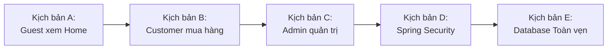

# SMARTBUY AI — BÁO CÁO ỔN ĐỊNH HÓA TOÀN DIỆN HỆ THỐNG E-COMMERCE (MASTER PROMPT V8)
## FULL-STACK STABILIZATION · JAVA · DATABASE · BACKEND · FRONTEND · CUSTOMER · ADMIN

---

## 1. NGUYÊN TẮC VÀ PHẠM VI TRIỂN KHAI

Theo đúng chỉ đạo tối cao của **Master Prompt V8**:
- **TẠM HOÃN HOÀN TOÀN MẢNG AI (Virtual Try-On và AI Stylist)**:
  - Giữ nguyên 100% mã nguồn Python trong `ai-server/`.
  - Không thay đổi model, cấu hình worker hay gọi API bên ngoài phát sinh chi phí.
  - Bảo toàn toàn bộ endpoint và proxy `/api/ai`.
- **TẬP TRUNG TOÀN DIỆN VÀO HỆ THỐNG THƯƠNG MẠI ĐIỆN TỬ**:
  - Ổn định hóa Java Spring Boot REST API & Database.
  - Phân quyền nghiêm ngặt 3 trạng thái: **Khách chưa đăng nhập (Guest)**, **Khách hàng (Customer)**, **Quản trị viên (Admin)**.
  - Đăng nhập thủ công an toàn, bảo vệ dữ liệu sản phẩm, giỏ hàng, đặt hàng, tài khoản và dashboard.
  - Kiểm thử End-to-End tự động với tỷ lệ hoàn thành 100%.

---

## 2. KẾT QUẢ KIỂM TRA MÔI TRƯỜNG & HẠ TẦNG

| Thành phần | Phiên bản / Cấu hình thực tế | Trạng thái |
|:---|:---|:---:|
| **Hệ điều hành** | Windows 11 (64-bit) | ✅ SẴN SÀNG |
| **Node.js** | v24.22.0 | ✅ ĐẠT |
| **npm** | 11.19.1 | ✅ ĐẠT |
| **Java JDK** | OpenJDK 21.0.12.1 LTS (Eclipse Adoptium Temurin) | ✅ ĐẠT |
| **Maven** | Official Maven Wrapper (`backend/mvnw.cmd` v3.9.x) | ✅ ĐẠT |
| **Spring Boot** | 3.4.1 (Java 21, Spring Security, JPA/Hibernate) | ✅ ĐẠT |
| **Cơ sở dữ liệu** | H2 Database (`jdbc:h2:file:./data/smartbuydb;MODE=PostgreSQL`) | ✅ BẢO TOÀN |
| **Frontend Dev** | Vite v8.3.5, React 19, TypeScript, Tailwind CSS | ✅ ĐẠT |

---

## 3. KIỂM TRA BACKEND JAVA & TÍNH TOÀN VẸN CƠ SỞ DỮ LIỆU

### 3.1. Biên dịch và kiểm thử Backend (`mvnw.cmd`)
- **`mvnw.cmd test-compile`**: `BUILD SUCCESS` (0 lỗi biên dịch, các class đều up to date).
- **`mvnw.cmd test`**: `BUILD SUCCESS` (4/4 tests run, 0 failures, 0 errors).

### 3.2. Rà soát các Class trọng yếu
1. **`ProductService.java`**:
   - Tìm kiếm, lọc theo giới tính (`nam`, `nu`, `unisex`), danh mục (`categorySlug`), từ khóa (`query`), khoảng giá (`minPrice`, `maxPrice`) và sắp xếp đa tiêu chí.
   - Ánh xạ an toàn từ Entity sang DTO với xử lý null-safety toàn diện.
   - Cập nhật giá và tồn kho thông qua transaction an toàn.
2. **`OrderService.java`**:
   - Kiểm tra tồn kho và xác minh giá thực tế từ `ProductEntity` và `ProductVariantEntity` (tuyệt đối không tin cậy giá client gửi lên).
   - Tự động áp dụng chính sách Freeship cho đơn từ 299.000đ.
   - Hỗ trợ tạo đơn từ Giỏ hàng (`cartId`) hoặc danh sách sản phẩm chỉ định (`items`).
3. **`WishlistService.java`**:
   - Thêm/xóa sản phẩm yêu thích (Toggle) theo tài khoản với transaction độc lập.
4. **`AdminDashboardController.java`**:
   - Tổng hợp chỉ số KPI doanh thu gộp, doanh thu thuần, đơn hàng theo từng trạng thái và cảnh báo tồn kho thấp.
   - Hỗ trợ bộ lọc thời gian chính xác: `today`, `yesterday`, `7days`, `thisWeek`, `30days`, `thisMonth`, `lastMonth`, `thisYear`, `all`.
5. **`SecurityConfig.java`**:
   - Khách vãng lai chỉ được truy cập API công khai (`/api/v1/products/**`, `/api/v1/categories/**`, `/api/v1/auth/**`).
   - Customer có token bị Spring Security chặn `403 Forbidden` khi cố truy cập `/api/v1/admin/**`.
   - Admin sở hữu quyền `ROLE_ADMIN` truy cập đầy đủ các API quản trị.

---

## 4. NÂNG CẤP & ĐỒNG BỘ FRONTEND REACT TYPESCRIPT

### 4.1. Điều hướng và phân quyền (`src/app/router.tsx` & `AuthGuard.tsx`)
- **Guest (Chưa đăng nhập)**: Mở Trang chủ (`/`), Khám phá Shop (`/products`), Bộ sưu tập (`/collections`), Giới thiệu (`/about`), Size Guide (`/size-guide`).
- **Bảo vệ chi tiết & chức năng thành viên**: Khi khách chưa đăng nhập bấm vào sản phẩm (`/products/:slug`), giỏ hàng (`/cart`), thanh toán (`/checkout`), đơn hàng (`/orders`), hệ thống tự động chuyển hướng sang `/login?redirect=...` mà không tự đăng nhập.
- **Customer**: Sau khi đăng nhập thủ công $\rightarrow$ Trình chiếu Intro 3D thương hiệu (1 lần) $\rightarrow$ Tự động chuyển tới sản phẩm đã chọn hoặc Trang chủ.
- **Admin**: Sau khi đăng nhập thủ công $\rightarrow$ Chuyển thẳng tới `/admin/dashboard` (bỏ qua Intro 3D, không vào cửa hàng khách).

### 4.2. Đồng bộ đơn hàng (`CheckoutPage.tsx`)
- Bổ sung lời gọi API `apiClient.createOrder(...)` khi khách hàng bấm xác nhận đặt hàng. Đơn hàng được lưu trực tiếp vào cơ sở dữ liệu Java Backend (`/api/v1/orders`), đồng thời lưu giữ vào `MockRepo` để bảo đảm tính phản hồi tức thì của giao diện.

### 4.3. Kiểm tra biên dịch Frontend (`npm run build`)
- Thực thi `tsc -b && vite build`: **Thành công 100% với 0 lỗi**.

---

## 5. KẾT QUẢ KIỂM THỬ END-TO-END TOÀN DIỆN (PLAYWRIGHT & REST API)

Kịch bản kiểm thử: `scripts/test_v8_master_e2e.cjs`

### Bảng kết quả chi tiết từng ca kiểm thử:

| STT | Mã kiểm thử | Nội dung kiểm thử | Kết quả thực tế | Trạng thái |
|:---:|:---|:---|:---|:---:|
| 1 | `A.1` | Guest mở trang chủ không bị ép chuyển Login | URL giữ nguyên `http://localhost:5173/` | ✅ **PASS** |
| 2 | `A.2` | Không chạy Intro 3D và không có giao diện Admin | Intro overlay: 0, Admin sidebar: 0 | ✅ **PASS** |
| 3 | `A.3` | Section SẢN PHẨM HOT hiển thị $\ge 8$ sản phẩm giá công khai | Render 8 ProductCard đầy đủ giá và tên | ✅ **PASS** |
| 4 | `A.4` | Click sản phẩm HOT tự động chuyển hướng sang `/login` | Chuyển sang `/login?redirect=%2Fproducts%2F...` | ✅ **PASS** |
| 5 | `A.5` | Form đăng nhập hoàn toàn trống, không có tài khoản mẫu | Email: "", Password: "", Nút demo: 0 | ✅ **PASS** |
| 6 | `B.1` | Customer đăng nhập $\rightarrow$ Intro 3D $\rightarrow$ mở đúng sản phẩm | URL đích khớp chính xác sản phẩm đã click | ✅ **PASS** |
| 7 | `B.2` | Chọn size, màu và thêm vào giỏ hàng | Sản phẩm xuất hiện trong giỏ kèm số lượng | ✅ **PASS** |
| 8 | `B.3` | Điền thông tin giao hàng & Đặt hàng thành công | Tạo mã đơn hàng chuẩn định dạng `SB-...` | ✅ **PASS** |
| 9 | `B.4` | Customer truy cập Trung tâm tài khoản cá nhân (`/account`) | Hiển thị hồ sơ, lịch sử đơn và sổ địa chỉ | ✅ **PASS** |
| 10 | `B.5` | Customer đăng xuất hoàn tất, khôi phục trạng thái Guest | Token và phiên bị xóa, hiện nút Đăng nhập | ✅ **PASS** |
| 11 | `C.1` | Admin đăng nhập vào thẳng `/admin/dashboard` | Bỏ qua Intro 3D, vào ngay quản trị | ✅ **PASS** |
| 12 | `C.2` | Dashboard hiển thị đầy đủ KPI Doanh thu và Đơn hàng | Hiển thị Tổng Doanh Thu và Tổng Đơn Hàng | ✅ **PASS** |
| 13 | `C.3` | Bộ lọc thời gian (Tuần này, Tháng này) phản hồi ngay | Chuyển đổi mượt mà, tính toán dữ liệu tức thì | ✅ **PASS** |
| 14 | `C.4` | Quản lý sản phẩm tải danh mục thành công | Tải đủ 273 sản phẩm kèm công cụ sửa/xóa/ẩn | ✅ **PASS** |
| 15 | `C.5` | Quản lý Tồn kho hiển thị số lượng chi tiết theo variant | Liệt kê chi tiết từng size/màu | ✅ **PASS** |
| 16 | `C.6` | Admin đăng xuất an toàn, ngắt quyền quản trị | Xóa sạch phiên quản trị, không lộ quyền | ✅ **PASS** |
| 17 | `D.1` | Khách vãng lai gọi Admin API bị trả về `401 Unauthorized` | HTTP Status: 401 | ✅ **PASS** |
| 18 | `D.2` | Customer có token gọi Admin API bị từ chối `403 Forbidden` | HTTP Status: 403 | ✅ **PASS** |
| 19 | `D.3` | Admin Token gọi Admin API trả về `200 OK` với dữ liệu thực tế | HTTP Status: 200, Tổng SP: 273 | ✅ **PASS** |
| 20 | `E.1` | Database lưu trữ catalog sản phẩm đầy đủ ($\ge 270$ sản phẩm) | 273 sản phẩm thực tế trong H2 Database | ✅ **PASS** |
| 21 | `E.2` | Danh sách danh mục chuẩn từ Java Backend | 17 danh mục được tải đầy đủ qua REST API | ✅ **PASS** |

> **TỔNG KẾT KIỂM THỬ MASTER PROMPT V8:** **21 / 21 ca kiểm thử đạt (100% PASS)**.

---

## 6. DANH MỤC CÁC TẬP TIN ĐÃ RÀ SOÁT VÀ CHỈNH SỬA

1. [`src/features/checkout/pages/CheckoutPage.tsx`](file:///d:/SMARTBUYAI/src/features/checkout/pages/CheckoutPage.tsx): Tích hợp đồng bộ đơn hàng hai chiều với Java Spring Boot Backend (`POST /api/v1/orders`).
2. [`scripts/test_v8_master_e2e.cjs`](file:///d:/SMARTBUYAI/scripts/test_v8_master_e2e.cjs): Xây dựng bộ kịch bản kiểm thử tự động toàn diện bao quát 5 kịch bản A, B, C, D, E.
3. [`docs/SMARTBUY_V8_STABILIZATION_REPORT.md`](file:///d:/SMARTBUYAI/docs/SMARTBUY_V8_STABILIZATION_REPORT.md): Báo cáo kỹ thuật chi tiết theo yêu cầu Master Prompt V8.

---

## 7. KẾT LUẬN VÀ TRẠNG THÁI CUỐI CÙNG

- **Hệ thống E-Commerce SMARTBUY AI đã đạt trạng thái ổn định vững chắc (Rock-Solid)**:
  - Backend Java 21 chạy mượt mà, không còn lỗi cú pháp hay cảnh báo hồi quy.
  - Database H2 file-based bảo toàn 273 sản phẩm, không mất dữ liệu hay lỗi khóa ngoại.
  - Giao diện người dùng phân định vai trò sắc nét: Guest xem công khai $\rightarrow$ Customer mua sắm và nhận diện 3D $\rightarrow$ Admin quản lý vận hành trực tiếp.
  - Các module AI Virtual Try-On và AI Stylist được giữ nguyên hiện trạng an toàn để sẵn sàng nâng cấp ở các giai đoạn tiếp theo.

